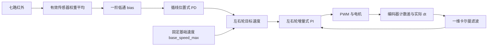

# STM32 Car

基于 **STM32F103C8 + 标准外设库** 的双轮差速小车项目，围绕编码器测速、速度闭环、七路红外循线和蓝牙串口调试逐步开发。

程序采用 **裸机主循环 + SysTick 时间戳 + 周期任务**，当前控制链路为“红外偏差 → 循线 PD → 左右轮目标速度 → 卡尔曼滤波反馈 → 增量式 PI → PWM”。

## 分支与功能状态

| 分支 | 用途 |
| --- | --- |
| `line-following` | 现有循线功能与调试基线，默认分支 |
| `remote-control` | 后续遥控功能开发，创建时与循线分支使用同一基线 |

当前源码中的功能状态如下。这里的“已接入”表示程序中存在调用链，不等同于对所有硬件、速度或赛道条件完成验证。

| 模块 | 当前状态 |
| --- | --- |
| 电机驱动 | TIM1 双路 PWM，底层占空比接口支持正负方向；当前速度 PI 输出限制为 `0～1` |
| 编码器测速 | TIM2 / TIM3 双相编码器接口，按实际采样间隔换算轮速 |
| 速度闭环 | 左右轮独立一维卡尔曼滤波，滤波结果接入增量式 PI |
| 红外循线 | 七路数字输入、加权偏差、一阶低通、位置式 PD 差速控制 |
| 速度规划 | 按偏差降速及加减速限制的任务已编写并调度；当前循线目标仍使用 `base_speed_max`，尚未采用规划结果 `base_speed` |
| 蓝牙串口 | USART1 + DMA，周期发送八通道波形数据 |
| 遥控与在线调参 | 已有接收缓冲及 DMA / IDLE 中断代码，尚无完整命令解析到电机目标的控制链路 |
| OLED | 已初始化，启动时显示固定的 `motor`、`turn` 文本 |
| MPU6050 | 已保留 I²C / DMA 与姿态处理代码；主函数未启用初始化，任务周期为 `0`，当前停用 |
| ADC 电位器 | ADC1 + DMA 已初始化，保留 `GetTarget()` 调试接口；当前不作为循线速度目标 |

## 工程结构

以下以独立小车仓库的根目录为准；在原学习仓库中，对应目录为 `stm32-smartcar/`。

```text
.
├── User/                   # 应用、驱动与控制逻辑
│   ├── main.c              # 外设初始化与主循环
│   ├── Tasks.c/.h          # 周期任务表与调度
│   ├── SysTick.c/.h        # 1 ms 系统时基
│   ├── motor.c/.h          # PWM、方向控制、编码器、ADC、速度任务
│   ├── PID.c/.h            # 增量式 / 位置式 PID 等控制器
│   ├── filter.c/.h         # 左右轮卡尔曼状态与滤波速度
│   ├── IR.c/.h             # 七路红外采集与循线状态处理
│   ├── SpeedDecision.c/.h  # 基础速度规划
│   ├── BlueTooth.c/.h      # USART1、DMA 与八通道波形上报
│   ├── OLED.c/.h           # 软件 I²C OLED 驱动
│   ├── IMU.c/.h            # MPU6050 驱动与姿态处理
│   └── vofa.c/.h           # 旧 USART2 调试方案，当前未启用
├── Library/                # STM32F10x 标准外设库
├── Start/                  # 启动文件、CMSIS 内核与系统时钟配置
├── RTE/                    # Keil 运行环境相关文件
├── .cmsis/                 # CMSIS 配套文件
├── .pack/                  # 设备支持包相关文件
├── .eide/                  # Embedded IDE 工程配置
├── cJSON/                  # JSON 库，预留给后续协议处理
├── kalman_filter/          # 卡尔曼滤波库及本地修改
├── project.uvprojx         # Keil 工程
├── project.code-workspace  # VS Code 工作区
├── 接线.txt                # 历史接线记录
└── 初始化.txt              # 外设、DMA 与调试笔记
```

## 硬件与引脚

硬件方案包括 STM32F103C8、双路电机驱动板、两只带编码器电机、七路红外模块和串口蓝牙模块，另保留 OLED、电位器及 MPU6050 接口。原笔记中的电机驱动板为 L298N。

下表按当前初始化和读写代码整理。旧笔记中的“五路红外”“单路光槽计数”“PA7 蓝牙 STATE”等记录属于早期方案。

| 功能 | MCU 引脚 | 外设 / 说明 |
| --- | --- | --- |
| 右轮 PWM | PA8 | TIM1_CH1 |
| 左轮 PWM | PA9 | TIM1_CH2 |
| 右轮方向 | PB12、PB13 | 初始化为 `1、0`；负占空比时反向 |
| 左轮方向 | PB14、PB15 | 初始化为 `1、0`；负占空比时反向 |
| 右轮编码器 A / B | PA0、PA1 | TIM2_CH1 / CH2 |
| 左轮编码器 A / B | PA6、PA7 | TIM3_CH1 / CH2 |
| 蓝牙 TX / RX | PB6、PB7 | USART1 重映射；MCU TX 接模块 RX |
| 蓝牙 STATE 预留 | PA10 | 配置为输入，当前没有依据连接状态启停车辆的逻辑 |
| 电位器滑动端 | PA3 | ADC1_IN3，DMA1_Channel1 |
| OLED SCL / SDA | PA12、PA11 | 软件 I²C |
| MPU6050 SCL / SDA | PB8、PB9 | I²C1 重映射，当前停用 |

七路红外在 `IR_GPIO[]` 中按下表排列：

| 数组索引 | 引脚 | 权重 |
| --- | --- | --- |
| 0 | PB11 | -3 |
| 1 | PB10 | -2 |
| 2 | PB1 | -1 |
| 3 | PB5 | 0 |
| 4 | PB0 | +1 |
| 5 | PA5 | +2 |
| 6 | PA4 | +3 |

代码按**黑线输出高电平**处理。实际安装时应逐个遮挡传感器，核对横向顺序、输出极性与偏差方向；左右轮的正方向也应与编码器反馈符号对应。编码器、红外和串口信号的电平兼容性按实际模块确认。

## 程序运行方式

### 初始化与任务调度

`main()` 设置中断分组与 1 ms 时基，依次初始化 OLED、电机 PWM、编码器、ADC、红外、速度规划器和蓝牙，随后初始化任务时间戳，在主循环中反复调用 `Tasks_Run()`。

SysTick 中断只递增 `uwTick`；周期任务在主循环中执行，不使用 RTOS。任务按表中顺序扫描，属于协作式调度，不是抢占式优先级。

| 顺序 | 任务 | 配置周期 | 作用 |
| --- | --- | --- | --- |
| 1 | `motor_Task()` | 10 ms | 测速、滤波、PI、更新 PWM |
| 2 | `IMU_Task()` | 0 ms | 周期为零，调度器跳过 |
| 3 | `Decision_Task()` | 20 ms | 更新规划基础速度 `base_speed` |
| 4 | `IR_Task()` | 20 ms | 读取红外、处理状态、设置左右轮目标 |
| 5 | `BlueToothVofa_Task()` | 50 ms | 发送调试数据 |

以上为标称调度周期，任务执行耗时会影响实际调用间隔。电机测速使用实际时间差计算速度；调度器不会补跑错过的周期。

### 循线与速度闭环



正常循线时，计算高电平传感器权重的平均值，并通过 `bias += 0.5 × (raw - bias)` 进行平滑。PD 以 `0` 为目标偏差，输出左右轮差速量：

```text
左轮目标 = base_speed_max - IR_PID.output
右轮目标 = base_speed_max + IR_PID.output
```

两轮速度分别经卡尔曼滤波后送入增量式 PI，输出限制为 `0～1`。目标速度小于等于零时，`PID_motor()` 清除控制器状态；虽然底层 `SetDuty*()` 支持负值切换方向，当前速度控制链路仍为正向速度控制。

红外状态处理：

- **正常检测**：更新偏差及左右轮目标，重置失线计时起点标志。
- **全部检测**：偏差置零，左右轮目标均设为 `base_speed_max`。
- **失线**：偏差置零，进入失线计时，未立即清除已有轮速目标；计时达到约 3 秒后关闭中断、将 PWM 置零并停留在死循环，需要复位重新运行。

`Decision_Task()` 已计算按偏差降速、限制加减速度的 `base_speed`，但当前 `IR_Task()` 使用的是 `base_speed_max`。因此，当前循线行为不能描述为已启用弯道自适应调速或规划式软启动。

### 当前关键参数

| 参数 | 源码当前值 | 位置 |
| --- | --- | --- |
| 系统时钟配置 | 72 MHz；普通 F103 配置的 HSE 默认值为 8 MHz | `Start/system_stm32f10x.c`、`Start/stm32f10x.h` |
| PWM 配置 | PSC = 9，ARR = 7199；72 MHz 定时器时钟下为 1 kHz | `User/motor.c` |
| 轮半径 | 0.0325 m | `User/motor.c` |
| 每输出轴转计数 | `13 × 90 × 4 = 4680` | `User/motor.c` |
| 左右轮速度 PI | Kp = 0.90，Ki = 0.03，Kd = 0 | `motor_arg_init()` |
| 一维卡尔曼 | 初值 x = 0、P = 0.01；当前本地库默认 Q = R = 0.1 | `motor_arg_init()`、`kalman1_init()` |
| 循线 PD | Kp = 0.05，Kd = 0.3，输出限幅 ±0.2 m/s | `IR_Task_Init()` |
| 基础速度 | `base_speed_max = 0.25 m/s` | `User/IR.c` |

这些值是当前工程的设置。轮径、计数倍率、反馈符号和控制参数应随实际电机、供电与机械结构校准；其中 4680 是代码采用的换算值，README 不将其作为独立测量结论。PI / PD 的离散计算未显式按 `dt` 归一化，修改任务周期后需要重新核对参数。

## 获取与构建

### 获取独立仓库

```bash
git clone --branch line-following https://github.com/greeopia/stm32-car.git
cd stm32-car
```

独立仓库迁移后的 `cJSON/` 与 `kalman_filter/` 已直接保存源码，构建当前分支不需要初始化这两个子模块。依赖快照来源记录在独立仓库的 `DEPENDENCIES.md` 中；较早的历史提交仍保留当时的子模块形式。

### 开发环境

| 项目 | 当前配置 |
| --- | --- |
| MCU | STM32F103C8，Cortex-M3 |
| 编译器 | ARM Compiler 5；Keil 工程记录为 V5.06 update 7，build 960 |
| 固件库 | STM32F10x 标准外设库 |
| 工程入口 | `.eide/eide.yml` 或 `project.uvprojx` |
| 设备包 | EIDE 配置为 STM32F1xx_DFP 2.3.0；Keil 配置为 2.4.1 |
| 存储布局 | EIDE 配置 Flash 64 KiB，RAM 20 KiB |
| 下载配置 | EIDE 使用 ST-Link / SWD，Flash 起始地址 `0x08000000` |

### VS Code / Embedded IDE

1. 打开 `project.code-workspace`，加载 `.eide/eide.yml`。
2. 配置本机 ARM Compiler 5 路径及相应 STM32F1 设备包，选择 `Target_1`。
3. 核对源文件包含 `cJSON/cJSON.c`、`cJSON/cJSON_Utils.c` 和 `kalman_filter/kalman_filter.c`，同一源文件只参与一次编译。
4. 执行完整重建，并检查最终链接结果。EIDE 输出目录配置为 `build/`。
5. 按实际调试器设置下载选项，使用本次构建产物烧录。

### Keil MDK

`project.uvprojx` 保留了早期配置，**使用前需要同步依赖路径**：

1. 将失效的 `User/cJSON.c`、`User/cJSON.h`、`User/cJSON_Utils.c/.h` 条目改为实际的 `cJSON/` 路径。
2. 加入 `kalman_filter/kalman_filter.c`，并保留 `User/filter.c`。
3. 在头文件搜索路径中加入工程根目录 `.`，保留 `Start`、`User`、`Library`，以支持 `cJSON/...`、`kalman_filter/...` 的包含方式。
4. 选择 ARM Compiler 5、匹配的设备包及 `Target_1`，执行 Rebuild。

Keil 配置的输出目录为 `Objects/`，已勾选生成 HEX。以上步骤依据现有配置整理；本 README 编写过程中未执行重建、烧录或新增实车验证。根目录 `Makefile` 为工具生成文件，带有本机工具链路径，使用前也应核对源文件列表。

## 波形调试

当前使用 **USART1（PB6 / PB7），115200、8N1、无硬件流控**，经蓝牙串口或匹配的串口连接上位机。选择支持 JustFloat 帧的解析方式。

默认每 50 ms 发送一帧：八个 32 位浮点数，随后是 `00 00 80 7F` 帧尾，共 36 字节。

| 通道 | 当前数据 | 单位 / 含义 |
| --- | --- | --- |
| CH0 | `bias` | 平滑后的红外偏差 |
| CH1 | `IR_PID.output` | 循线差速量，m/s |
| CH2 | `L_filter_speed` | 左轮滤波速度，m/s |
| CH3 | `R_filter_speed` | 右轮滤波速度，m/s |
| CH4 | `LmotorTarget` | 左轮目标速度，m/s |
| CH5 | `RmotorTarget` | 右轮目标速度，m/s |
| CH6 | `GetDutyl()` | 左轮 PWM 占空比幅值 |
| CH7 | `GetDutyr()` | 右轮 PWM 占空比幅值 |

通道含义以 `BlueToothVofa_Task()` 的实际赋值为准，头文件中的早期通道注释尚未同步。`VOFA_SHOW_RAW_PULSES` 当前为 `0`；其诊断分支引用的原始计数变量已注释，不能只改为 `1` 就认为原始脉冲上报可用。

蓝牙接收侧当前只保留缓冲与中断处理框架。cJSON 已纳入工程，但尚未定义可直接使用的遥控指令或 JSON 调参协议。

## 调试与后续开发

首次运行或更换电机后，建议先架空车轮，分别核对左右轮驱动方向、编码器反馈符号和速度换算，再检查七路红外顺序，最后进行落地循线。上电后程序会自动进入任务循环，当前没有独立的遥控解锁或启动握手。

后续重点：

- 在 `remote-control` 分支定义命令格式，补齐接收、解析、目标速度分配和连接超时停车。
- 将 `base_speed` 规划结果接入循线目标，并重新验证起步、弯道和失线行为。
- 核对蓝牙 DMA 接收缓冲边界、回绕与分帧处理。
- 同步 Keil / EIDE 工程配置，记录完整构建步骤与实车测试条件。

相关资料：[接线记录](接线.txt)、[初始化与调试笔记](初始化.txt)、[卡尔曼库说明](kalman_filter/README.md)、[cJSON 说明](cJSON/README.md)。历史笔记与当前实现不一致时，应结合源码和实物接线重新确认。
